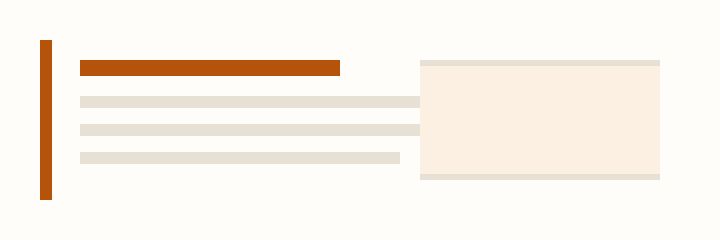
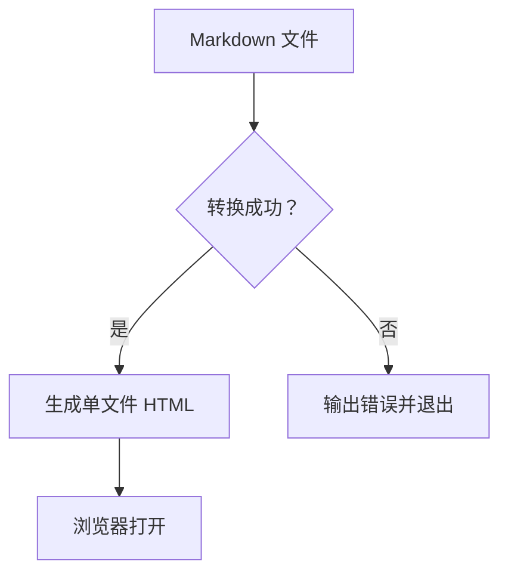

# 全部元素测试

这是一份用于检查转换效果的样例文档，覆盖标题、段落、列表、引用、表格、代码、图片、任务列表、链接、分隔线与 Mermaid 图。

## 行内元素

**粗体**、*斜体*、~~删除线~~、`行内代码`、[普通链接](https://example.com "示例站点")、<https://example.com>、**粗体里嵌 `代码`**。  
这是两个空格触发的硬换行后的第二行。

行内 HTML 也可以：<kbd>Ctrl</kbd> + <kbd>C</kbd>。

## 列表

### 无序列表

- 第一项
- 第二项
  - 嵌套子项
  - 另一个子项
- 第三项

### 有序列表

1. 第一步
2. 第二步
   1. 子步骤
   2. 另一个子步骤
3. 第三步

从 3 开始的有序列表：

3. 第三
4. 第四

### 任务列表

- [x] 已完成
- [ ] 未完成
- [x] 带 `代码` 的完成项

#### 四级标题不进目录

这一节用来确认目录只收录二级和三级标题。

## 引用

> 一级引用。
>
> > 嵌套引用，里面有 **强调** 和 `代码`。
>
> 回到一级引用。

## 表格

| 左对齐 | 居中 | 右对齐 |
| :--- | :---: | ---: |
| 甲 | 乙 | 1 |
| 较长的单元格内容 | `code` | 200 |

宽表用来检查横向滚动：

| 列一 | 列二 | 列三 | 列四 | 列五 | 列六 | 列七 | 列八 |
| --- | --- | --- | --- | --- | --- | --- | --- |
| 内容 | 内容 | 内容 | 内容 | 内容 | 内容 | 内容 | 内容 |
| 更长的内容 | 更长的内容 | 更长的内容 | 更长的内容 | 更长的内容 | 更长的内容 | 更长的内容 | 更长的内容 |

## 代码

```python
def greet(name: str) -> str:
    """返回问候语。"""
    return f"你好，{name}！"


print(greet("世界"))
```

```javascript
const items = [1, 2, 3];
const doubled = items.map((n) => n * 2);
console.log(doubled);
```

```bash
python -m md2html "笔记.md" --open
ls -la ./samples
```

```html
<section class="demo">
  <p>一段 HTML，用来检查高亮与转义。</p>
</section>
```

```css
.demo {
  color: #b45309;
  background: #fbf0e2;
  border-radius: 10px;
}
```

```json
{
  "name": "md2html",
  "singleFile": true,
  "offline": true
}
```

```text
这是一段没有专门高亮规则的纯文本。
<尖括号> & 符号都应原样显示。
```

```
未标语言的代码块也按纯文本处理。
```

## 分隔线

---

## 图片



## Mermaid



## 长文阅读

这是一段较长的中文正文，用来检查行高、字号、段落间距和阅读节奏。Markdown 写起来简单，但直接看纯文本总是少一点排版感；转成 HTML 以后，标题层级、引用块和表格才有明显的视觉结构。排版舒服与否很难量化，通常要连续读上几分钟才能感觉到差异：行距太紧会让人不自觉地跳行，太松又显得松散；字号在窄屏上略小一点通常更耐读。

这一段的第二句故意写得长一些，包含英文单词 Markdown、HTML、CSS，也包含数字 2026 和标点，用来观察中英混排与断行是否自然。下面再放一个较短的段落，检查段间距是否一致。

短段落。

## 结尾

到这里所有主要元素都出现过了。可以用 `--no-toc` 和 `--no-mermaid` 再各转换一次，对比目录与图库的变化。
